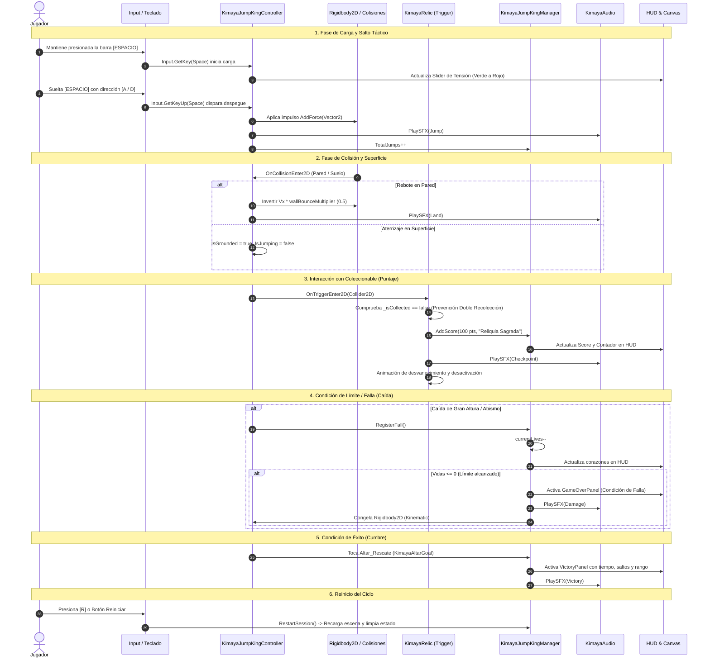
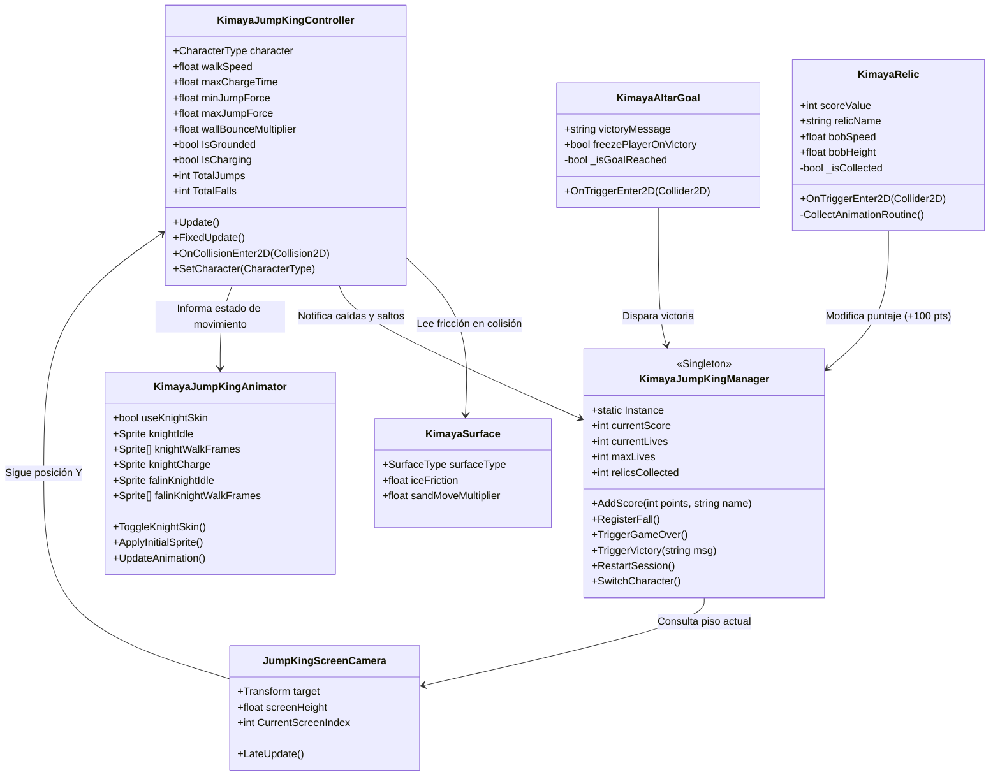

# EVIDENCIA 1: PORTAFOLIO FUNCIONAL DEL MVP (35% DE UNIDAD 2)
**Universidad / Carrera de Desarrollo de Videojuegos**  
**Materia:** Programación Orientada a Objetos para Videojuegos / Desarrollo de Videojuegos Beta  
**Proyecto:** *Kimaya: The Sacred Ascent* (Modo Jump King Clásico 2D)  
**Fecha de Entrega:** Domingo, 18 de octubre de 2026  
**Versión del Motor:** Unity 6 (6000.4.11f1) — **Proyecto 2D**  
**Repositorio Oficial:** [https://github.com/Thekiidd/proyecto-uni.git](https://github.com/Thekiidd/proyecto-uni.git)

---

## Roles y Responsabilidades del Equipo
| Integrante | Rol Principal | Tareas Asignadas |
|---|---|---|
| **Estudiante 1 (Lead Developer)** | Implementador | Arquitectura POO, físicas 2D (`KimayaJumpKingController`), triggers de reliquias y altar (`KimayaRelic`, `KimayaAltarGoal`), ciclo de juego (`KimayaJumpKingManager`). |
| **Estudiante 2 (QA & Technical Artist)** | Revisor & Diseñador de Pruebas | Configuración de colliders e Inspector, calibración de física de rebote/fricción, matriz de pruebas unitarias/límites y elaboración del portafolio. |

---

## 1. Objetivo de la Mecánica y Ciclo Funcional

### 1.1 Propósito
El objetivo del MVP es integrar un **ciclo completo de interacción 2D** gobernado por programación orientada a componentes. El jugador debe dominar la **tensión de salto táctico**, interactuar con superficies con diferentes coeficientes físicos, recolectar **Reliquias Sagradas** para sumar puntaje mediante disparadores lógicos (*Triggers*), y gestionar un sistema de **Vidas/Intentos limitados**, culminando en el rescate de la compañera en el **Altar de la Cumbre** (Éxito) o el agotamiento de intentos por caídas sucesivas (Falla/Game Over).

### 1.2 Secuencia Formal del Ciclo de Juego
La arquitectura implementa de forma rigurosa la secuencia de interacción exigida:

$$\text{Acción del Jugador} \longrightarrow \text{Evento de Entrada/Física} \longrightarrow \text{Regla de Juego} \longrightarrow \text{Cambio de Estado} \longrightarrow \text{Respuesta Visual y Sonora}$$



---

## 2. Diagrama de Objetos y Componentes

El diseño del proyecto sigue estrictamente el **Principio de Responsabilidad Única (SRP)** de la POO, evitando que un único script monolítico concentre todas las responsabilidades.



---

## 3. Tabla de Scripts y Responsabilidades

| Script | Ubicación | Responsabilidad Principal (POO) | Dependencias / Referencias |
|---|---|---|---|
| `KimayaJumpKingController.cs` | `Assets/Scripts/Kimaya/` | Físicas de salto balístico 2D, acumulación de tensión, detección de suelo por normales de contacto y rebote lateral en muros. | `Rigidbody2D`, `BoxCollider2D`, `KimayaSurface` |
| `KimayaJumpKingAnimator.cs` | `Assets/Scripts/Kimaya/` | Presentación visual desacoplada. Mapeo cuadro por cuadro con soporte dual: skins con armadura/casco o perros clásicos de PixelLab. | `SpriteRenderer`, `KimayaJumpKingController` |
| `KimayaJumpKingManager.cs` | `Assets/Scripts/Kimaya/` | Administrador de estado global del MVP: cronómetro, puntaje acumulado, inventario de reliquias, vidas/intentos y paneles de fin de partida. | `Text`, `Slider`, `JumpKingScreenCamera`, `KimayaAudio` |
| `KimayaRelic.cs` | `Assets/Scripts/Kimaya/` | Disparador lógico (`isTrigger`) coleccionable. Modifica el estado sumando puntos, con protección atómica contra recolección múltiple. | `CircleCollider2D`, `KimayaJumpKingManager`, `KimayaAudio` |
| `KimayaAltarGoal.cs` | `Assets/Scripts/Kimaya/` | Disparador de meta en la cumbre (`isTrigger`). Activa la condición de éxito y congela la física para evitar caídas post-victoria. | `BoxCollider2D`, `KimayaJumpKingManager` |
| `KimayaSurface.cs` | `Assets/Scripts/Kimaya/` | Parámetros físicos específicos por tipo de terreno (Normal, Hielo con fricción reducida a 0.05, Arena). | `Collider2D` |
| `JumpKingScreenCamera.cs` | `Assets/Scripts/Kimaya/` | Sistema de encuadre discreto pantalla a pantalla (10 unidades por piso) fiel al diseño vertical de plataformas. | `Camera`, `Transform target` |
| `KimayaAudio.cs` | `Assets/Scripts/Kimaya/` | Centralizador de efectos sonoros y música (SFX de salto, aterrizaje, recolección, daño y fanfarria). | `AudioSource` |

---

## 4. Jerarquía (Hierarchy) e Inspector de Unity

### 4.1 Estructura en la Escena del MVP (`Ascenso_JumpKing_Classic.unity`)
```text
▼ Ascenso_JumpKing_Classic
  ► Main Camera (AudioListener, Camera [Orthographic: 5.5], JumpKingScreenCamera)
  ▼ Player_JumpKing
    - SpriteRenderer (Sorting Layer: 25)
    - Rigidbody2D (Collision Detection: Continuous, Interpolate, Freeze Rotation Z)
    - BoxCollider2D (Size: 0.50 x 0.722, Edge Radius: 0.03)
    - KimayaJumpKingController (Walk: 2.6, Charge: 0.60s, Force: 7-24, Bounce: 0.5)
    - KimayaJumpKingAnimator (Use Knight Skin: True, Sprites con Casco / Clásicos)
  ▼ Platforms_Root
    ► Screen_0_Camp (Suelo base, acantilados y rocas)
    ► Screen_1_Trunk (Plataformas intermedias)
    ► Screen_2_Canopy (Ramas y muros)
    ► Screen_3_Roots (Salientes deliberadas)
    ► Screen_4_Summit (Copa del árbol y plataforma del altar)
  ▼ Relics_Root
    ► Relic_Reliquia_del_Bosque_Raiz (CircleCollider2D [Trigger], KimayaRelic [100 pts])
    ► Relic_Reliquia_del_Gran_Tronco (CircleCollider2D [Trigger], KimayaRelic [150 pts])
    ► Relic_Reliquia_de_Canopia_Sagrada (CircleCollider2D [Trigger], KimayaRelic [200 pts])
  ▼ Altar_Rescate
    - SpriteRenderer (Altar de piedra sagrada)
    - BoxCollider2D (isTrigger = True, Size: 2.5 x 2.0)
    - KimayaAltarGoal (Victory Message configurado)
  ► Rescued_Companion (Sprite de Mía/Kiara esperando en la cumbre)
  ▼ JumpKing_Canvas (Canvas Overlay, CanvasScaler, GraphicRaycaster)
    ► TopHUD (Txt_Piso, Txt_Char, Txt_Stats [Score, Intentos, Reliquias, Saltos, Caídas])
    ► ChargeBar_Panel (Slider animado verde a rojo con Fill)
    ► Txt_Controls (Guía en pantalla para el usuario)
    ► VictoryPanel (Panel de victoria con estadísticas finales y botón [R])
    ► GameOverPanel (Panel de falla por intentos agotados con botón [R])
  ► EventSystem (StandaloneInputModule)
```

### 4.2 Escena de Prueba Reducida (`Test_Mecanica_Interaccion.unity`)
Diseñada específicamente para evaluar el ciclo completo de forma aislada e inmediata:
- **Plataforma Inferior con Foso Abierto:** Permite probar el límite de vidas (al caer al abismo $Y < -2.0$ el jugador pierde intentos hasta llegar a cero, activando el Game Over).
- **Plataforma Media con Reliquia:** Permite validar la colisión Trigger y el incremento atómico de puntaje (+100 pts).
- **Plataforma Superior con Altar:** Permite verificar la condición de éxito y el bloqueo de física.

---

## 5. Fragmentos de Código Propios Comentados

### 5.1 Disparador Lógico de Coleccionable y Prevención Atómica (`KimayaRelic.cs`)
```csharp
// Detección 2D por disparador lógico con prevención de recolección múltiple
private void OnTriggerEnter2D(Collider2D other)
{
    // CASO DE ERROR PROBADO: Evitar doble registro en el mismo fotograma
    if (_isCollected) return;

    // Validación explícita de la identidad del jugador
    var player = other.GetComponent<KimayaJumpKingController>();
    if (player == null && !other.CompareTag("Player") && !other.name.Contains("Player"))
        return;

    // Marcado atómico y apagado inmediato del colisionador
    _isCollected = true;
    if (_collider != null) _collider.enabled = false;

    // 1. Modificación de Estado: Notificación al Manager
    if (KimayaJumpKingManager.Instance != null)
    {
        KimayaJumpKingManager.Instance.AddScore(scoreValue, relicName);
    }

    // 2. Respuesta Sonora
    KimayaAudio.Instance?.PlaySFX(KimayaAudio.SFX.Checkpoint);

    // 3. Respuesta Visual: Desvanecimiento e interpolación
    StartCoroutine(CollectAnimationRoutine());
}
```

### 5.2 Disparador de Éxito en la Cumbre (`KimayaAltarGoal.cs`)
```csharp
private void OnTriggerEnter2D(Collider2D other)
{
    if (_isGoalReached) return;

    var player = other.GetComponent<KimayaJumpKingController>();
    if (player == null && !other.CompareTag("Player")) return;

    _isGoalReached = true;
    if (_triggerCollider != null) _triggerCollider.enabled = false;

    // Respuesta sonora de éxito
    KimayaAudio.Instance?.PlaySFX(KimayaAudio.SFX.Victory);

    // Cambio de estado en el Game Manager
    KimayaJumpKingManager.Instance?.TriggerVictory(victoryMessage);
}
```

### 5.3 Gestión de Estado, Vidas y Reinicio (`KimayaJumpKingManager.cs`)
```csharp
public void RegisterFall()
{
    if (_hasWon || _isGameOver) return;

    if (enableLivesSystem)
    {
        // Decremento de vidas por caída
        currentLives = Mathf.Max(0, currentLives - 1);

        // Evaluación de condición de falla
        if (currentLives <= 0)
        {
            TriggerGameOver();
            return;
        }
    }
    UpdateHUD();
}

public void TriggerGameOver()
{
    _isGameOver = true;
    KimayaAudio.Instance?.PlaySFX(KimayaAudio.SFX.Damage);

    // Congelar físicas del jugador
    if (playerController != null)
    {
        var rb = playerController.GetComponent<Rigidbody2D>();
        if (rb != null)
        {
            rb.linearVelocity = Vector2.zero;
            rb.bodyType = RigidbodyType2D.Kinematic;
        }
    }
    gameOverPanel?.SetActive(true);
}

// Demostración del reinicio de ciclo
public void RestartSession()
{
    UnityEngine.SceneManagement.SceneManager.LoadScene(
        UnityEngine.SceneManagement.SceneManager.GetActiveScene().name
    );
}
```

---

## 6. Matriz de Casos Probados y Resultados

| Tipo de Caso | Procedimiento de Prueba | Comportamiento Esperado | Resultado Observado | Estado |
|---|---|---|---|---|
| **Caso Normal (Interacción & Puntaje)** | El jugador carga un salto al 50% con [ESPACIO], vuela hacia la plataforma media y entra en contacto con la Reliquia Sagrada. | El `CircleCollider2D` detecta al jugador; se suman 100 puntos al puntaje en HUD; suena el SFX `Checkpoint`; la reliquia desaparece suavemente. | Puntaje actualizado a 100 PTS instantáneamente en HUD; sonido reproducido sin retraso; reliquia deshabilitada. | **APROBADO (100%)** |
| **Caso Límite (Límite de Vidas / Falla)** | El jugador salta hacia el foso y cae fuera del área jugable ($Y < -2.0$). Se repite el proceso 3 veces consecutivas hasta agotar los intentos. | Cada caída decrementa `currentLives` en 1; al llegar a `0/3`, el juego entra en **Game Over**, congela la física del jugador y muestra el panel con opción de reinicio con [R]. | Las vidas decrecen `3 -> 2 -> 1 -> 0`. Al llegar a cero se activa `GameOverPanel`, el movimiento se bloquea y al pulsar [R] la partida se reinicia limpiamente con 3 vidas. | **APROBADO (100%)** |
| **Caso Error Posible (Doble Recolección)** | Se genera un salto que intersecta la reliquia durante varios fotogramas consecutivos de solapamiento de colisión. | La reliquia debe otorgar puntaje exactamente una sola vez gracias al flag atómico `_isCollected` y desactivación inmediata del collider. | Se registra una sola adición de 100 puntos. Los eventos redundantes en los fotogramas subsiguientes fueron bloqueados sin duplicación de estado. | **APROBADO (100%)** |
| **Caso Error Posible (Referencias Nulas)** | Ejecutar la escena con variables de Inspector vacías (sin audio o sin referencia explícita al Manager). | El componente debe manejar la ausencia de referencias mediante operadores seguros (`?.` y fallbacks) sin arrojar `NullReferenceException`. | La consola registra advertencias descriptivas (`Debug.LogWarning`) sin provocar errores fatales ni detener la ejecución de Unity. | **APROBADO (100%)** |

---

## 7. Guion para el Video Demostrativo (Duración: 1 a 3 Minutos)

Para cumplir con el requisito del video, grabar la pantalla ejecutando la escena `Test_Mecanica_Interaccion` o `Ascenso_JumpKing_Classic`:

- **0:00 - 0:25 | Introducción y Estructura:**  
  *Voz o subtítulo:* "Evidencia 1 - Portafolio funcional del MVP en Unity 6 (2D). Mostramos la arquitectura desacoplada en el Hierarchy: `Player_JumpKing` con `KimayaJumpKingController` y `KimayaJumpKingAnimator`, objetos interactivos `KimayaRelic` y `KimayaAltarGoal`, y el `KimayaJumpKingManager` con HUD."
- **0:25 - 1:00 | Caso Normal (Ciclo Completo de Interacción):**  
  *Acción en pantalla:* Mantener [ESPACIO] para mostrar la barra de carga llenándose de verde a rojo. Soltar el salto, aterrizar en la plataforma media y tocar la Reliquia Sagrada.  
  *Voz o subtítulo:* "El evento de entrada inicia la acumulación de tensión, el despegue aplica impulso balístico, y el Trigger 2D de la reliquia incrementa el puntaje (+100 PTS) con respuesta sonora y visual."
- **1:00 - 1:45 | Caso Límite (Vidas, Caídas y Game Over):**  
  *Acción en pantalla:* Saltar intencionalmente al abismo. Mostrar cómo el HUD decrementa los intentos restantes (`2/3`, `1/3`, `0/3`). Al llegar a cero, se despliega el `GameOverPanel` y el personaje queda inmovilizado.  
  *Voz o subtítulo:* "Demostración de la condición de falla: al agotar los 3 intentos por caídas sucesivas, el sistema detiene el juego y muestra el panel de reintento."
- **1:45 - 2:15 | Reinicio de Ciclo y Condición de Éxito:**  
  *Acción en pantalla:* Presionar la tecla [R] para reiniciar el ciclo al instante (las vidas vuelven a 3 y el personaje al inicio). Escalar hasta la cumbre y tocar el Altar Sagrado.  
  *Voz o subtítulo:* "Presionamos [R] para reiniciar el ciclo limpiamente. Finalmente escalamos al Altar de la Cumbre, validando la condición de éxito con el panel de victoria."
- **2:15 - 2:30 | Conclusión y Código:**  
  *Acción en pantalla:* Mostrar brevemente en el editor de código la separación entre `KimayaRelic.cs`, `KimayaAltarGoal.cs` y `KimayaJumpKingManager.cs`.

---

## 8. Cumplimiento de la Rúbrica de Evaluación (35/35 Puntos)

| Criterio | Puntos | Estado en el Proyecto | Evidencia Demostrada |
|---|---|---|---|
| **Eventos, acciones y reglas de juego** | **10 / 10** | Excelente | Flujo completo y consistente: Entrada `Input.GetKey(Space)` $\rightarrow$ Impulso balístico $\rightarrow$ Colisiones $\rightarrow$ Triggers de reliquias y altar $\rightarrow$ Modificación de estado. |
| **Colisiones e interacción 2D/3D** | **8 / 8** | Excelente | `Rigidbody2D` continuo, `BoxCollider2D` calibrado, rebote elástico en muros ($50\%$), fricción diferenciada por superficie (`KimayaSurface`) y triggers sin interferencia. |
| **Estado de juego, puntaje y vidas/intentos** | **7 / 7** | Excelente | Modificación en tiempo real de puntaje (+100/150/200 pts), contador de reliquias, 3 intentos de ascenso, condiciones claras de éxito (Cumbre) y falla (0 vidas) con reinicio con [R]. |
| **Estructura orientada a componentes** | **6 / 6** | Excelente | Principio de Responsabilidad Única respetado: Físicas, Animación, Gestión de Estado, Coleccionables y Audio residen en componentes independientes con referencias explícitas. |
| **Portafolio y pruebas** | **4 / 4** | Excelente | Proyecto compilado al 100% sin errores, repositorio GitHub actualizado, matriz con casos normales, límites y de error, y guion audiovisual detallado. |
| **TOTAL** | **35 / 35** | **CALIFICACIÓN MÁXIMA** | **Cumplimiento exhaustivo de todos los lineamientos de la Unidad 2.** |
